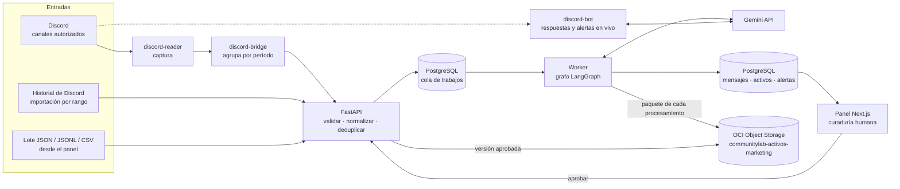
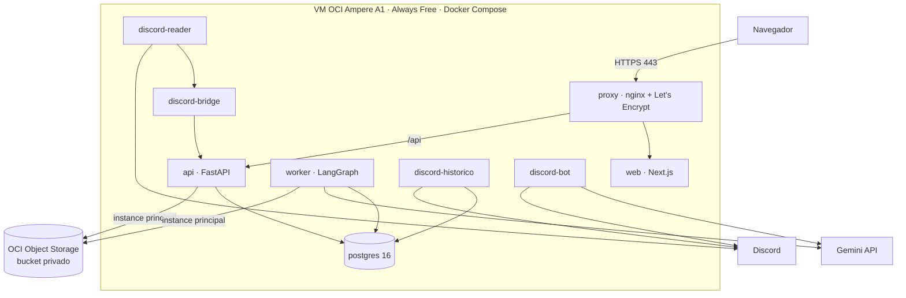
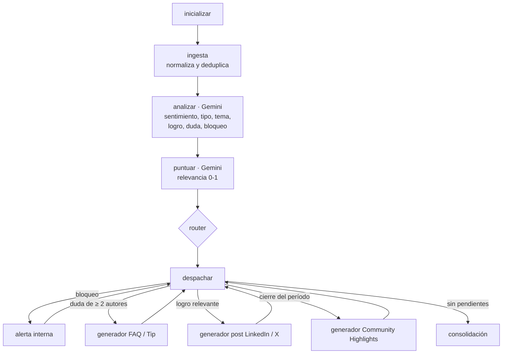

# CommunityLab 🚀


**Motor inteligente de transformación y distribución para comunidades digitales.**
Hackathon ONE G10 (Oracle Next Education + Alura) · No Country · Equipo 32.

CommunityLab escucha lo que pasa en una comunidad (Discord o lotes JSON/CSV), lo analiza con Gemini y lo
convierte en contenido listo para revisar y publicar: posts para LinkedIn y X, FAQ y tips, resúmenes
semanales (*Community Highlights*) y alertas internas cuando alguien está bloqueado. Cada contenido
conserva sus mensajes fuente y pasa por curaduría humana. El paquete de cada procesamiento y cada versión
aprobada se guardan en **OCI Object Storage**.

- **Producción:** https://communitylab.nodnexa.com (VM ARM Always Free en OCI, con HTTPS).
- **Repositorio:** https://github.com/No-Country-simulation/G10-CommunityLabE32
- **Idiomas de la interfaz:** español, inglés y portugués de Brasil.

---

## Contenido

1. [Qué resuelve](#1-qué-resuelve)
2. [Cómo cumple el MVP de la hackathon](#2-cómo-cumple-el-mvp-de-la-hackathon)
3. [Funcionalidades](#3-funcionalidades)
4. [Arquitectura](#4-arquitectura)
5. [Pipeline de IA (LangGraph + Gemini)](#5-pipeline-de-ia-langgraph--gemini)
6. [Stack](#6-stack)
7. [Estructura del repositorio](#7-estructura-del-repositorio)
8. [Ejecutar en local](#8-ejecutar-en-local)
9. [Despliegue en OCI paso a paso](#9-despliegue-en-oci-paso-a-paso)
10. [API](#10-api)
11. [Seguridad](#11-seguridad)
12. [Pruebas](#12-pruebas)
13. [Datos de demostración](#13-datos-de-demostración)
14. [Documentación detallada](#14-documentación-detallada)
15. [Equipo](#15-equipo)
16. [Licencia](#16-licencia)

---

## 1. Qué resuelve

Las comunidades activas generan a diario logros, dudas repetidas y testimonios, pero ese valor se pierde
en el historial de los canales: revisar mensajes y escribir contenido a mano consume horas del equipo de
comunidad y marketing.

CommunityLab automatiza la parte repetitiva y deja la decisión en manos de una persona:

| La comunidad produce… | CommunityLab entrega… |
|---|---|
| «¡Me contrataron como desarrolladora junior!» | Un post para LinkedIn y X que celebra el logro, con su fuente |
| La misma duda de varias personas | Una FAQ o tip técnico de la semana |
| Toda la actividad del período | Un *Community Highlights* semanal |
| «Llevo tres días sin poder avanzar» | Una alerta interna para el equipo (nunca se publica) |
| Cientos de mensajes | Sentimiento, tipos de participación y temas en un panel |

## 2. Cómo cumple el MVP de la hackathon

| Requisito del documento | Cómo se cumple |
|---|---|
| Procesar interacciones de una comunidad (datos reales o simulados) | Ingesta de lotes JSON/JSONL/CSV desde el panel, captura en vivo de Discord e importación histórica de canales |
| Sentimiento, temas e historias relevantes con LLMs | Gemini analiza cada mensaje (sentimiento, tipo, tema, logro, duda, bloqueo) y puntúa su relevancia |
| Al menos dos formatos de activos | Post LinkedIn/X, FAQ/Tip técnico y Community Highlights, más banners SVG |
| Automatización con LangGraph o equivalente | Grafo LangGraph con nodos condicionales (sección 5), ejecutado por un worker en segundo plano |
| Bifurcación de condiciones | Router: bloqueo → alerta interna; duda de ≥ 2 autores → FAQ; logro relevante → post; cierre de período → highlights |
| Interfaz de visualización y aprobación | Panel Next.js con Resumen, Interacciones, Curaduría (aprobar, editar, denegar con motivo) y Analítica |
| **OCI Object Storage (obligatorio)** | En el bucket privado `communitylab-activos-marketing`, con la identidad de la VM y sin llaves: el paquete de **cada procesamiento** (`activos/<período>/<id>/paquete-distribucion.json`) y **cada versión aprobada** (`aprobados/<id>/v<versión>/activo.json` y `banner.svg`). Ingesta muestra «copia en OCI guardada» |
| Endpoint de procesamiento del enunciado | `POST /api/v1/procesar` acepta el JSON del documento tal cual y responde con su forma: `resumen_comunidad`, `activos_distribucion_generados` y `almacenamiento_oci` (sección 10) |
| Al menos 3 ejemplos de transformación | Guion de demo (`docs/guion-demo.md`) y lotes de prueba |
| OCI Compute (diferencial) | Toda la aplicación corre en una VM ARM Always Free con Docker Compose y HTTPS |
| Bot de comunidad (diferencial) | Bot de Discord que responde dudas técnicas y avisa de bloqueos en un canal interno |
| Imágenes para publicaciones (diferencial) | Banner por contenido aprobado (plantilla SVG), descargable en JPG |
| README con diagrama y guía de despliegue | Este archivo (secciones 4 y 9) |

## 3. Funcionalidades

| Pantalla | Qué permite |
|---|---|
| **Resumen** | Seis tarjetas de sentimiento (total, positivos, negativos, neutrales, indeterminados y sin analizar) que filtran los mensajes, más borradores pendientes, aprobados y alertas internas |
| **Ingesta de datos** | Conectar un canal de Discord con período y zona horaria (agrupadas por región de América Latina); la tarjeta recuerda la última importación. Subir lotes JSON/JSONL/CSV con seguimiento hasta la copia en OCI. «Procesar pendientes» de Discord sin cerrar la semana, sin volver a analizar lo ya importado. **Datos cargados**: ocultar o eliminar lotes (solo administradores) |
| **Interacciones** | Todos los mensajes con autor, tipo, tema y sentimiento; filtros por sentimiento y búsqueda en el servidor |
| **Curaduría** | Revisar cada borrador frente a sus fuentes, ver advertencias de fidelidad, editar versiones LinkedIn y X, regenerar con IA, compartir en LinkedIn o X, generar el banner y descargarlo en JPG, aprobar o denegar con motivo. Cada aprobado muestra si ya se guardó en OCI |
| **Analítica** | Distribución del sentimiento, embudo de curaduría (generados, pendientes, aprobados y denegados), temas recurrentes (las variantes del mismo tema se agrupan) y tipos de participación, filtrables por lotes |
| **Usuarios del equipo** | Alta de cuentas, roles (usuario, operador, administrador) y restablecimiento de contraseñas; en celular, cada cuenta es una tarjeta |
| **Configuraciones** | Perfil, contraseña, idioma (español, inglés, portugués de Brasil) y tema claro u oscuro |
| **Acerca del equipo** | Integrantes, roles, habilidades y enlaces a LinkedIn y GitHub |

Además, un **bot de Discord** responde dudas en tiempo real y avisa al equipo cuando detecta a alguien bloqueado.

## 4. Arquitectura

### Pipeline de punta a punta



### Despliegue en OCI



| Servicio | Función |
|---|---|
| `proxy` | nginx: HTTPS, redirección HTTP → HTTPS, cabeceras de seguridad, `/api` hacia la API |
| `web` | Panel Next.js |
| `api` | FastAPI: ingesta, procesamiento del enunciado, curaduría, métricas, cuentas y sesiones, copia en OCI de los aprobados |
| `worker` | Ejecuta el grafo LangGraph de cada lote con Gemini (o en modo simulado, sin red) y sube su paquete a OCI |
| `postgres` / `db-init` | Base de datos y migraciones aditivas |
| `discord-reader` | Captura mensajes de los canales autorizados |
| `discord-bridge` | Agrupa por período y entrega los lotes a la API |
| `discord-bot` | Responde dudas y envía alertas internas en vivo |
| `discord-historico` | Importa el historial de un canal en un rango de fechas |

## 5. Pipeline de IA (LangGraph + Gemini)

Cada lote recorre este grafo (`pipelines/communitylab/grafo.py`). Cualquier error lleva directo a la
consolidación: el lote falla entero y no deja borradores a medias.



**Reglas del router** (`router_base.py`), por mensaje y con esta precedencia: **bloqueo > duda recurrente > logro**.

| Condición | Ruta | Resultado |
|---|---|---|
| El análisis marca bloqueo | `bloqueo` | Alerta interna; el mensaje queda fuera de todo contenido público |
| Relevancia < 0,6 | — | Se descarta con motivo registrado |
| Duda sobre el mismo tema de ≥ 2 autores distintos (las variantes del tema con o sin tildes, artículos o plural cuentan como una) | `dudas` | FAQ / Tip técnico |
| Logro relevante sin otra ruta | `logro` | Post LinkedIn / X |
| `cierre_periodo = true` | `periodo` | Community Highlights con todos los mensajes relevantes |

**Controles sobre lo que genera la IA**
- **Fidelidad** (`generadores/fidelidad.py`): marca cifras, archivos, detalles o causas que no aparecen en
  las fuentes, y logros colectivos presentados como individuales. Curaduría pide confirmar antes de aprobar.
- **Trazabilidad:** cada activo guarda los IDs de sus mensajes fuente; el modelo nunca los elige.
- **Salida estructurada:** JSON con esquema y validación local estricta; una respuesta inválida escala al
  siguiente modelo o falla, nunca se usa a medias.
- **Presupuesto por lote:** tope de llamadas, tiempo y tokens. Ante un 429 por ritmo, espera lo que indica
  Gemini (configuración en `docs/gemini-grafo-worker.md`).

## 6. Stack

| Capa | Tecnología |
|---|---|
| Frontend | Next.js 16.3, React 19.2, TypeScript 5, Tailwind CSS 4, Framer Motion; interfaz en español, inglés y portugués de Brasil |
| API | FastAPI, SQLAlchemy async, Pydantic 2 (Python 3.12) |
| Orquestación | LangGraph 1.2, worker propio con cola en PostgreSQL (reintentos, *lease*, idempotencia) |
| IA | Google Gemini (`flash-lite` y escalamiento a un modelo mayor), cliente HTTP propio |
| Datos | PostgreSQL 16 |
| Integraciones | Discord (discord.py 2.7: gateway y API REST), bot con Gemini |
| Nube | OCI Compute (Ampere A1, Always Free) y OCI Object Storage (SDK `oci` 2.175, instance principal) |
| Operación | Docker Compose, nginx, Let's Encrypt, scripts `cl-*` con respaldo y reversión |

## 7. Estructura del repositorio

```text
backend/                 API FastAPI
  app/routers/           autenticación, mensajes, curaduría, métricas
  app/api/routes/        trabajos, Discord (histórico y escucha), datos cargados, banners, puente
  app/services/          ámbito de lotes, fidelidad, banners, OCI, autenticación
  scripts/               crear_usuario, recalcular_fidelidad, reclasificar_mensajes, oci_almacenamiento…
frontend/                Panel Next.js
pipelines/communitylab/  grafo LangGraph, router, cliente Gemini, generadores, puente de Discord
worker/                  cola en PostgreSQL, esquema (schema.sql) y pruebas de integración
integrations/discord/    lector, bot y procesador de Discord
ops/vm/                  despliegue, respaldo, restauración y reversión en la VM
infrastructure/          notas de OCI, Docker y Gemini
docs/                    documentación detallada (sección 14)
docker-compose.yml       servicios base · compose.https.yml (VM) · compose.discord.yml (Discord)
```

## 8. Ejecutar en local

Requisitos: Docker con Compose 2.24.4 o posterior.

1. **Configurar el entorno.**
   ```bash
   cp .env.example .env
   ```
   En `.env`:
   - `POSTGRES_PASSWORD`: una contraseña propia.
   - `DOCKER_PLATFORM`: `linux/amd64` en PC Intel/AMD, `linux/arm64` en ARM.
   - `JWT_SECRET_KEY`: 32 bytes aleatorios o más, por ejemplo con
     `python3 -c "import secrets; print(secrets.token_urlsafe(48))"`.
   - Deja `WORKER_MODE=simulado` para probar sin IA ni red. Con `WORKER_MODE=gemini`, define
     `GEMINI_API_KEY` y `GEMINI_MODELOS`.
2. **Levantar los servicios base** (proxy, web, api, worker y postgres):
   ```bash
   docker compose -f docker-compose.yml up -d --build
   ```
3. **Crear el primer administrador.** La contraseña se escribe sin eco:
   ```bash
   docker compose -f docker-compose.yml exec api python -m backend.scripts.crear_usuario --email tu@correo.com --rol administrador
   ```
4. **Entrar** en http://127.0.0.1:8080 y subir un lote desde **Ingesta de datos**. Formato mínimo:
   ```json
   {"interacciones": [{"id": "m-1", "autor": "Ana", "canal": "logros",
     "fecha": "2026-10-19T14:10:00Z", "texto": "¡Aprobé la certificación OCI!"}]}
   ```

Los servicios de Discord se agregan con `compose.discord.yml` y su configuración privada
(`integrations/discord/config-servicios.example/`).

## 9. Despliegue en OCI paso a paso

Todo usa recursos **Always Free**. Detalle completo en `docs/operacion-vm.md`.

### 9.1 Infraestructura en la consola de OCI

1. **VM:** instancia Ampere A1 (ARM) con Ubuntu, IP pública y los puertos 80 y 443 abiertos en la lista
   de seguridad. Instalar Docker y Compose.
2. **Dominio:** un registro A hacia la IP de la VM (en producción, `communitylab.nodnexa.com`; si el DNS está
   en Cloudflare, en modo **DNS only**, sin proxy) y el certificado de Let's Encrypt en
   `/etc/letsencrypt/live/<dominio>/`, emitido con los hooks que detienen y levantan el proxy:
   ```bash
   sudo certbot certonly --standalone --key-type ecdsa -d <dominio> \
     --pre-hook /usr/local/sbin/communitylab-certbot-pre --post-hook /usr/local/sbin/communitylab-certbot-post
   ```
   La renovación es automática (`certbot.timer`) y reutiliza esos hooks.
3. **Bucket:** en *Storage → Buckets*, un bucket **privado** y estándar
   (`communitylab-activos-marketing`).
4. **Acceso sin llaves (instance principal):**
   - Grupo dinámico (*Identity → Domains → Default → Dynamic groups*):
     ```text
     instance.id = '<OCID de la VM>'
     ```
   - Política en el compartimento raíz (crear, sobrescribir y leer objetos; no borrar):
     ```text
     Allow dynamic-group 'Default'/'<grupo>' to read objectstorage-namespaces in tenancy
     Allow dynamic-group 'Default'/'<grupo>' to read buckets in tenancy where target.bucket.name = '<bucket>'
     Allow dynamic-group 'Default'/'<grupo>' to manage objects in tenancy where all {target.bucket.name = '<bucket>', request.permission != 'OBJECT_DELETE'}
     ```

### 9.2 Aplicación en la VM

1. **Código** clonado en `/srv/communitylab`, propiedad del usuario de servicio `communitylab` (sin
   login), y los comandos `ops/vm/cl-*` instalados en `/usr/local/sbin`. En esta VM lo hizo
   `ops/vm/migrar-a-srv.sh` al mudar la aplicación desde su ruta anterior.
2. **`.env` privado** (permisos 600, fuera de Git), a partir de `.env.example`:
   - `COMPOSE_FILE=docker-compose.yml:compose.https.yml:compose.discord.yml`
   - `WORKER_MODE=gemini`, `GEMINI_API_KEY`, `GEMINI_MODELOS`
   - `JWT_SECRET_KEY`, `POSTGRES_PASSWORD`, `OPERADOR_TOKEN`, `PUENTE_TOKEN`
   - `OCI_ALMACENAMIENTO=instance_principal` (bucket en `OCI_BUCKET_NAME`)
   - Tokens y canales de Discord (`docs/operacion-vm.md`, «Variables privadas»)
3. **Desplegar un commit:**
   ```bash
   sudo cl-actualizar <sha> <ruta-al-.env-nuevo>
   ```
   Ejecuta seis puertas; si una falla, las siguientes no corren:
   1. guarda el estado actual para poder revertir;
   2. construye y prueba las imágenes en un worktree aislado;
   3. respalda la base y comprueba que el respaldo se restaura;
   4. aplica la migración (aditiva) con la versión anterior aún en servicio;
   5. hace el corte (única interrupción);
   6. verifica los servicios y HTTPS; si falla, revierte solo.
4. **Primer administrador:**
   ```bash
   sudo docker compose exec api python -m backend.scripts.crear_usuario --email <correo> --rol administrador
   ```
5. **Verificar OCI:**
   ```bash
   sudo docker compose exec api python -m backend.scripts.oci_almacenamiento --verificar
   ```
   Debe imprimir `escritura=ok lectura=ok`.
6. **Revertir** si hace falta: `sudo cl-revertir <estado>` (la carpeta la indica el despliegue).

## 10. API

Documentación interactiva en `/docs` (Swagger). Principales rutas:

| Área | Rutas |
|---|---|
| Procesamiento del enunciado | `POST /api/v1/procesar`, `GET /api/v1/procesar/{id}` |
| Ingesta | `POST /api/mensajes/procesamientos` (archivo), `POST /api/v1/trabajos`, `GET /api/v1/trabajos/{id}` |
| Mensajes y métricas | `GET /api/mensajes` (búsqueda `q`, lotes, sentimiento), `GET /api/dashboard/kpis`, `/alertas`, `/ambitos` |
| Curaduría | `GET/PATCH /api/curaduria/activos/{id}`, `POST .../posts/generar`, `GET/POST .../banners` |
| Datos cargados | `GET /api/v1/datos/lotes`, `PATCH .../visibilidad`, `POST .../eliminacion/vista-previa`, `POST .../eliminacion` |
| Discord | `/api/v1/discord/historico/*` (importar por rango), `/api/v1/discord/canales/{id}/escucha`, `/api/v1/procesamiento-pendientes` |
| Cuentas | `POST /api/auth/login`, `/logout`, `GET /api/auth/sesion`, `GET/POST/PATCH /api/auth/usuarios` |

### Procesamiento con el contrato del enunciado

`POST /api/v1/procesar` recibe el JSON del documento de la hackathon tal cual. Si faltan `id`, `fecha` o
`cierre_periodo`, se completan: ID y fecha estables, de modo que reenviar el mismo lote no lo duplica, y
cierre del período por defecto para generar también el resumen semanal. Requiere una sesión de operador o
el token del puente.

```json
{
  "origen_comunidad": "Discord_Grupo_ONE_G10",
  "periodo_referencia": "Semana_04",
  "interacciones": [
    {"autor": "Mariana Souza", "canal": "#logros-y-empleos", "tipo": "testimonio",
     "texto": "¡Quedé seleccionada como Desarrolladora Junior de IA gracias al proyecto de LangChain y OCI!"},
    {"autor": "Lucas Albuquerque", "canal": "#dudas-langgraph", "tipo": "pregunta_tecnica",
     "texto": "¿Cómo estructuro los nodos condicionales en LangGraph cuando el LLM necesita reintento?"}
  ]
}
```

Respuesta (resumida):

```json
{
  "status": "exito",
  "procesamiento_id": "…",
  "resumen_comunidad": {
    "total_interacciones_procesadas": 2,
    "sentimiento_predominante": "Altamente positivo",
    "temas_principales": ["contratación", "langgraph"],
    "alertas_internas": 0
  },
  "activos_distribucion_generados": {
    "post_linkedin": [{"titulo": "Logro de la comunidad", "copy": "…", "fuentes": ["…"], "estado": "borrador"}],
    "destaque_newsletter_semanal": [{"titulo": "Resumen de la comunidad", "copy": "…"}],
    "sugerencia_contenido_faq": []
  },
  "revision_humana": "pendiente_en_curaduria",
  "almacenamiento_oci": {
    "estado": "guardado",
    "bucket": "communitylab-activos-marketing",
    "ruta_objeto": "activos/Semana_04/<id>/paquete-distribucion.json"
  }
}
```

La respuesta llega en cuanto termina el análisis, con una espera máxima de 50 s. Si tarda más, devuelve
202 con `status: en_proceso` y el resultado se consulta en `GET /api/v1/procesar/{id}`. Los activos nunca
se publican solos: quedan como borradores en Curaduría.

`POST /api/v1/trabajos` es la vía asíncrona de la app y del puente de Discord: exige `id` y `fecha` por
mensaje y devuelve `202` con el ID del trabajo.

## 11. Seguridad

- **Sesiones:** cookie HttpOnly (`cl_sesion`) + token CSRF en memoria; nada de tokens en `localStorage`.
  Roles leídos de la base en cada petición; registro público cerrado; límite de intentos de login.
- **Permisos** por endpoint en `docs/politica-acceso.md`. Las acciones destructivas (eliminar lotes,
  gestionar cuentas) son solo de administradores.
- **Secretos:** solo en el `.env` privado de la VM (600). No hay credenciales predeterminadas; las
  contraseñas nunca van en argumentos ni en logs. OCI usa la identidad de la VM, sin llaves.
- **Contenedores:** usuarios no root, sistemas de archivos de solo lectura donde aplica, sin puertos
  publicados salvo el proxy.
- **IA:** los mensajes de bloqueo nunca llegan a contenido público; todo contenido pasa por aprobación humana.

## 12. Pruebas

- **Worker, API y PostgreSQL** (`worker/tests/`): ingesta, flujo híbrido, curaduría, búsqueda, tipos y
  temas, nombres de Discord, OCI con cliente falso, datos cargados y una batería de acceso y seguridad.
- **Grafo y Gemini** (`pipelines/communitylab/tests/`): router, presupuesto, fidelidad y cliente con
  transporte falso (sin red ni claves).
- **Discord** (`integrations/discord/*/tests`) y **operación de la VM** (`ops/vm/tests/`: puertas de
  despliegue, respaldo, restauración y reversión con Docker real).
- **CI en GitHub Actions** en cada PR: título con convención de commits, grafo, Discord, PostgreSQL,
  proxy HTTP/HTTPS y operación de la VM.

## 13. Datos de demostración

La demo usa 500 mensajes de soporte al cliente en español, repartidos en 5 semanas (W39 a W43), con
autores, canales y fechas ficticios. Los textos provienen del dataset público
[Bitext customer support (español)](https://huggingface.co/datasets/Faramir/Bitext-customer-support-llm-chatbot-training-dataset-spanish),
licencia **CDLA-Sharing-1.0**. No contienen datos personales reales.

## 14. Documentación detallada

| Documento | Tema |
|---|---|
| `docs/operacion-vm.md` | Operación de la VM: rutas, variables, despliegue, respaldo y reversión |
| `docs/http-local-https-vm.md` | HTTP local y HTTPS en la VM |
| `docs/gemini-grafo-worker.md` | Cliente Gemini, presupuesto por lote y política de errores |
| `docs/oci-object-storage.md` | Paquetes de cada procesamiento y copia de los aprobados en OCI; acceso por instance principal |
| `docs/guion-demo.md` | Guion de la demostración |
| `docs/ingesta-lotes.md` | Formatos de lote, resultados del worker y datos cargados |
| `docs/flujo-hibrido-banners.md` | «Procesar pendientes», cierre de período y banners |
| `docs/discord-historico.md` | Importación histórica de canales de Discord |
| `docs/metricas-panel.md` | Cómo se calcula cada métrica del panel |
| `docs/politica-acceso.md` | Roles, sesiones y permisos por endpoint |

## 15. Equipo

Nombres y roles tal como figuran en la plataforma de No Country (equipo G10-LATAM-equipo 32).

| Integrante | Rol | GitHub |
|---|---|---|
| Ianjaner Alfonso Beltran Guañarita | Full Stack Developer | [@ianjaner75](https://github.com/ianjaner75) |
| Fredy Pachon | Backend Developer | [@FredyPachon](https://github.com/FredyPachon) |
| Paulo Andres Escobar Solorzano | Autonomous Agent Engineer | [@AndresS-max](https://github.com/AndresS-max) |
| Santiago Horta Hurtado | Autonomous Agent Engineer | [@TIANHH77](https://github.com/TIANHH77) |
| Fabian Hernández Alejandro | Prompt Engineer | [@Fabianhernandez23](https://github.com/Fabianhernandez23) |
| Jose Angel Olan de los Santos | Data Engineer | [@JoseOlannn](https://github.com/JoseOlannn) |
| Vania Sherel Cruz Hernandez | Vibe Coder | [@vaniasherel](https://github.com/vaniasherel) |
| Elizabeth Aguilar | Project Manager | [@LizAg1804](https://github.com/LizAg1804) |

## 16. Licencia

El código se distribuye bajo la licencia [MIT](LICENSE) · © 2026 Equipo 32 · CommunityLab (No Country,
Hackathon ONE G10). Los datos de demostración conservan su propia licencia (sección 13).
