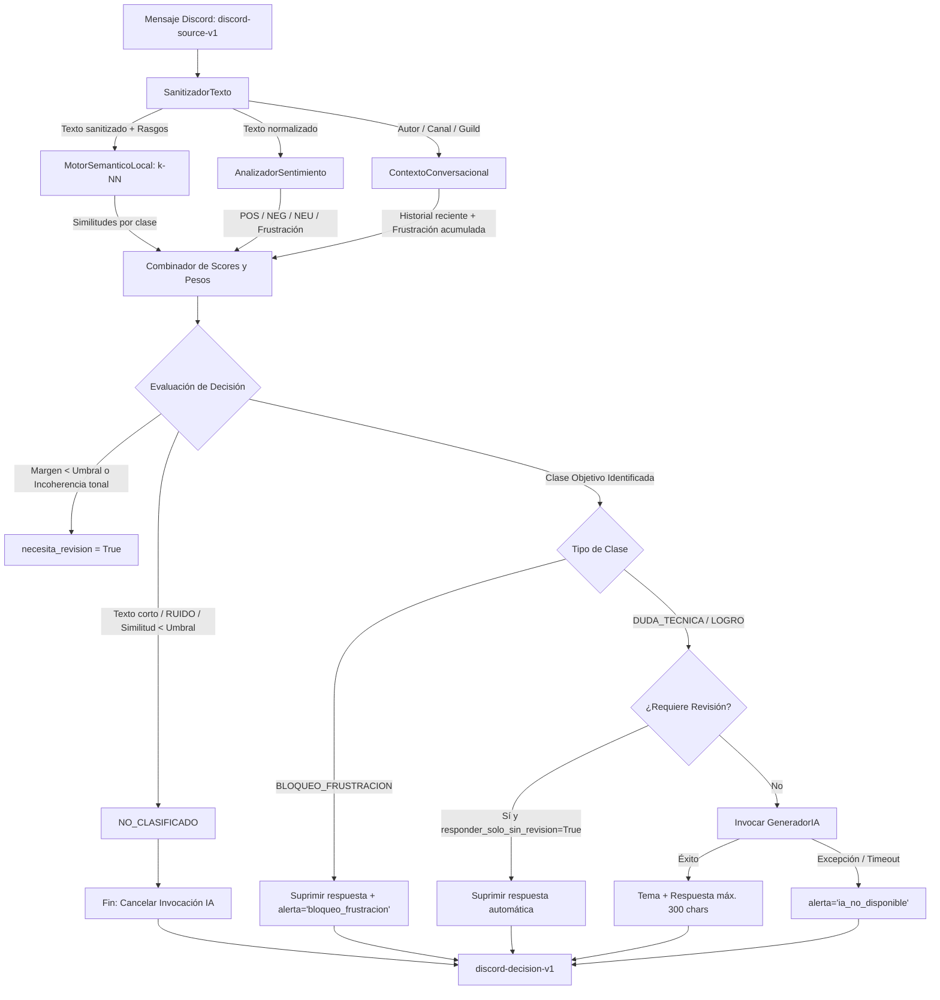

# Clasificador de Interacciones

## 1. Arquitectura del Pipeline

El procesamiento de cada interacción se estructura en cinco etapas secuenciales:

1. **`SanitizadorTexto`**: Normaliza menciones, canales, emotes, URLs y emojis a tokens neutros. Extrae rasgos booleanos: presencia de trazas de error, bloques de código, mayúsculas sostenidas, preguntas y señales léxicas de frustración.
2. **`MotorSemanticoLocal`**: Calcula similitud semántica contra prototipos mediante $k\text{-NN}$ (promedio de los top-$k$ cosenos por clase). Emplea sentence-transformers con degradación automática a TF-IDF de $n$-gramas de caracteres ($3 \le n \le 5$) en ausencia de dependencias neuronales.
3. **`AnalizadorSentimiento`**: Estima probabilidades de polaridad (`POS`, `NEG`, `NEU`) y frustración usando `pysentimiento` o un motor léxico de contingencia.
4. **`ContextoConversacional`**: Ventana deslizante temporal por tupla `(guild_id, channel_id, author_id)`. Desambigua mensajes cortos e identifica frustración acumulada.
5. **Enrutamiento y Puerto IA**: Pondera scores (semántica + sentimiento + rasgos), evalúa umbrales y márgenes de decisión. Solo si el resultado corresponde a una clase objetivo invoca el puerto generativo externo.

### **Diagrama de Flujo del Pipeline**



### **Bloques de Implementación del Pipeline**

La lógica central del clasificador está modularizada en seis bloques funcionales ordenados por responsabilidad:

- **Bloque #1: Sanitización y Extracción de Rasgos (`SanitizadorTexto`)**
Convierte elementos ruidosos de Discord (menciones, canales, emotes y URLs) en tokens neutros (`<CODIGO>`, `<ERROR>`, `<URL>`, etc.). Extrae indicadores booleanos críticos para la clasificación: mayúsculas sostenidas, preguntas sintácticas, trazas de error y expresiones idiomáticas de frustración o malestar.
- **Bloque #2: Motor Semántico Local (`MotorSemanticoLocal`)**
Calcula la distancia vectorial entre el mensaje analizado y los prototipos etiquetados usando $k\text{-NN}$ (promedio de los top-$k$ cosenos por clase). Implementa degradación controlada: usa embeddings neuronales (sentence-transformers) si están disponibles y retrocede a un vectorizador TF-IDF de $n$-gramas de caracteres (VectorizadorCaracteres) en entornos ligeros.
- **Bloque #3: Análisis de Tono y Frustración (`AnalizadorSentimiento`)**
Genera la distribución de probabilidad afectiva (`POS`, `NEG`, `NEU`) y un índice específico de frustración. Emplea un modelo transformador de lenguaje (`pysentimiento`) o un analizador léxico determinista basado en patrones y conteos de frecuencia si no hay aceleración GPU/PyTorch.
- **Bloque #4: Memoria de Conversación (`ContextoConversacional`)**
Mantiene un búfer en memoria acotado por tiempo (`ventana_segundos`) e indexado por `(guild_id, channel_id, author_id)`. Permite enriquecer mensajes cortos o elípticos (e.g. *"no funciona"*, *"sí, ya quedó"*) con mensajes previos del mismo autor y contabilizar eventos de frustración acumulada en la sesión activa.
- **Bloque #5: Puerto de Generación Desacoplado (`GeneradorIA`)**
Define el protocolo abstracto (`Protocol`) y las estructuras de datos (`GeneracionSalida`, `MAX_RESPUESTA`) para desacoplar el bot de cualquier proveedor LLM (OpenAI, Gemini, Anthropic). Garantiza que fallos de red o latencias en modelos externos no bloqueen el clasificador.
- **Bloque #6: Enrutamiento, Ponderación y Decisión (`ClasificadorInteracciones`)**
Núcleo decisor del pipeline. Pondera las similitudes semánticas con los pesos de sentimiento y rasgos sintácticos mediante un combinador lineal; aplica normalización softmax con temperatura para calcular la confianza; impone las reglas de descarte (longitud mínima, ruido, umbral mínimo); evalúa márgenes de ambigüedad para activar `necesita_revision` y emite el contrato final `DiscordDecisionV1`.

## 2. Contratos de Datos (I/O)

### Entrada: `discord-source-v1`

Representado por `DiscordSourceV1` o diccionarios conformes al esquema:

| Campo | Tipo | Restricción / Formato |
| --- | --- | --- |
| `schema_version` | `str` | Valor exacto: `"discord-source-v1"` |
| `message_id` | `str` | Identificador del mensaje (parseado a `str`) |
| `guild_id` | `str` | Identificador del servidor |
| `channel_id` | `str` | Identificador del canal |
| `author_id` | `str` | Identificador del usuario |
| `created_at` | `str` / `datetime` | Marca de tiempo ISO 8601 normalizada a UTC |
| `content` | `str` | Contenido textual original |

### Salida: `discord-decision-v1`

Representado por `DiscordDecisionV1` o diccionarios exportables:

| Campo | Tipo | Descripción |
| --- | --- | --- |
| `schema_version` | `str` | Valor exacto: `"discord-decision-v1"` |
| `message_id` | `str` | Coincidente con la entrada |
| `es_duda` | `bool` | `True` si clasifica como `DUDA_TECNICA` |
| `es_logro` | `bool` | `True` si clasifica como `LOGRO` |
| `es_bloqueo` | `bool` | `True` si clasifica como `BLOQUEO_FRUSTRACION` |
| `tema` | `str` | Tema detectado por el generador (por defecto `"general"`) |
| `respuesta` | `str` | Texto redactado para responder (máx. 300 caracteres) |
| `alerta` | `str` | Señales operativas (`"bloqueo_frustracion"`, `"malestar_no_tecnico"`, `"ia_no_disponible"`) |

## 3. Integración del Puerto Generativo (`GeneradorIA`)

El desacoplamiento del modelo generativo sigue una arquitectura de puertos y adaptadores. El clasificador no realiza llamadas de red directas ni gestiona SDKs externos.

### Protocolo de Integración

```python
from classifier import ClasificacionResultado, DiscordSourceV1, GeneracionSalida

class ProveedorLLM:
    """Implementa el protocolo GeneradorIA."""
    def generar(self, fuente: DiscordSourceV1, resultado: ClasificacionResultado) -> GeneracionSalida:
        # fuente.content: texto íntegro
        # resultado.clase: DUDA_TECNICA | LOGRO | BLOQUEO_FRUSTRACION
        # resultado.similitudes: diccionario de distancias semánticas

        # Invocación al cliente LLM (OpenAI, Anthropic, Gemini, etc.)
        return GeneracionSalida(
            tema="docker",
            respuesta="Verifica la directiva EXPOSE en tu Dockerfile.",
            alerta=""
        )
```

### Reglas de Negocio Automatizadas

1. **Filtrado de Ruido:** Mensajes categorizados como `NO_CLASIFICADO` o `RUIDO` cancelan la invocación a la IA, ahorrando consumo de tokens.
2. **Comportamiento por Clase:**
    - `DUDA_TECNICA` / `LOGRO`: Transmiten `respuesta`; suprimen alertas.
    - `BLOQUEO_FRUSTRACION`: Suprimen `respuesta` (el bot no responde al usuario afectado); generan `alerta`.
3. **Revisión Humana:** Si `necesita_revision=True` y `responder_solo_sin_revision=True`, el bot anula la respuesta automática para dar paso a un moderador.
4. **Tope de Caracteres:** Truncamiento rígido a 300 caracteres (`MAX_RESPUESTA`).
5. **Aislamiento de Excepciones:** Si el generador falla, la excepción no aborta el lote; se reporta `alerta="ia_no_disponible"` manteniendo la clasificación estructural.

## 4. API de Uso

```python
from classifier import ClasificadorInteracciones, DiscordSourceV1

# Inicialización con generador opcional
clf = ClasificadorInteracciones(generador=ProveedorLLM(), forzar_fallback=False)

# 1. Clasificación desde dataclass
entrada = DiscordSourceV1(
    schema_version="discord-source-v1",
    message_id="101",
    guild_id="server_1",
    channel_id="canal_dudas",
    author_id="user_50",
    created_at="2026-10-12T10:00:00Z",
    content="¿Cómo se define una clave compuesta en SQLAlchemy?"
)
decision = clf.clasificar(entrada)

# 2. Diagnóstico detallado
decision, diag = clf.clasificar_detallado(entrada)
# Acceso a: diag.confianza, diag.motivos, diag.similitudes, diag.necesita_revision

# 3. Payload JSON dict directo
decision_dict = clf.clasificar_payload({
    "schema_version": "discord-source-v1",
    "message_id": "102",
    "guild_id": "server_1",
    "channel_id": "general",
    "author_id": "user_12",
    "created_at": "2026-10-12T10:05:00Z",
    "content": "jajaja qué buen meme"
})

# 4. Ingesta de corrección en memoria (bucle de moderación)
clf.registrar_correccion(
    texto="No levanta el daemon tras actualizar paquetes",
    clase_correcta="DUDA_TECNICA"
)
```

## 5. Herramientas de Mantenimiento

### Calibración Offline (`calibrador.py`)

Ajusta hiperparámetros mediante descenso coordenado y suavizado de mesetas sin alterar el archivo `config_clasificador.json` original:

```
python calibrador.py --dataset datos.jsonl --etapas clase,revision,confianza --salida reporte.json
```

## 6. Resultados de Validación y Calibración

Evaluación ejecutada sobre un benchmark representativo de 140 muestras balanceadas (35 por clase) utilizando motor semántico `embeddings` y análisis con `pysentimiento`:

### Métricas de Desempeño

| Métrica | Base (Sin calibrar) | Calibrado | Variación |
| --- | --- | --- | --- |
| **Exactitud** | 82.86% | **93.57%** | +10.71% |
| **F1 Macro** | 0.828 | **0.937** | +0.109 |
| **F1 `DUDA_TECNICA`** | 0.750 | **0.939** | +0.189 |
| **F1 `NO_CLASIFICADO`** | 0.786 | **0.957** | +0.171 |
| **F1 `BLOQUEO_FRUSTRACION`** | 0.849 | **0.909** | +0.060 |
| **F1 `LOGRO`** | 0.925 | **0.941** | +0.016 |
| **F1 Detección de Errores (Revisión)** | 0.308 | **0.414** | +0.106 |
| **Tasa de Casos Derivados a Revisión** | 10.71% | 14.29% | +3.58% |

### Matriz de Confusión Resultante