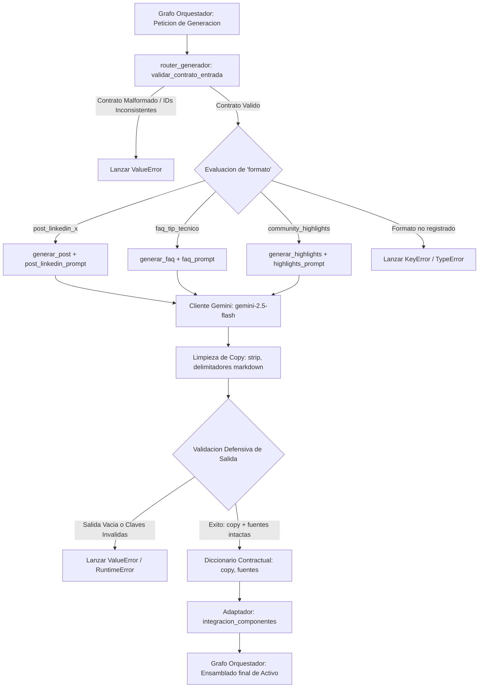

# Nota: integración_componentes_example.py

## TODO (integración/arquitectura):
La dataclass `Componentes` también está definida en el módulo del grafo.
Mantener dos definiciones idénticas genera dos tipos distintos para Python,
por lo que una instancia creada aquí puede no superar validaciones como:

     isinstance(componentes, Componentes)

cuando el grafo comprueba contra su propia definición.

Recomendación: utilizar la definición canónica de `Componentes` del módulo
del grafo e importarla aquí, eliminando la duplicidad. Esta corrección
corresponde al responsable de la definición del contrato compartido entre
integración y orquestación.


# Agentes Generadores de Activos (MVP)

Prototipo desacoplado de agentes generativos impulsados por Modelos de Lenguaje (LLM) para la síntesis y redacción automatizada de activos de contenido comunitario (`post_linkedin_x`, `faq_tip_tecnico`, `community_highlights`), diseñado bajo cumplimiento estricto de contratos para su integración con el grafo orquestador central.

## 1. Arquitectura del Pipeline Generativo

El flujo de ejecución de los agentes generadores opera de forma aislada a las fases previas de análisis y scoring, procesando las solicitudes a través de cinco etapas secuenciales:

1. **Recepción y Validación de Contrato (`router_generador`)**: Inspecciona la presencia y consistencia de los campos obligatorios del contrato de entrada. Verifica que la lista `fuentes` no contenga elementos vacíos ni duplicados, y asegura que cada identificador en `fuentes` tenga su contraparte correspondiente en `interacciones`.
2. **Despacho y Enrutamiento Funcional (`dispatch_generator`)**: Evalúa el campo `formato` para direccionar el contrato hacia la función generadora especializada (`generar_post`, `generar_faq` o `generar_highlights`), desacoplando la lógica de negocio de la infraestructura del grafo.
3. **Serialización Contextual y Ensamblado de Prompts**: Transforma las interacciones estructuradas en texto contextual para el modelo y aplica el *System Prompt* correspondiente con directivas estrictas contra alucinaciones, tono y formato.
4. **Inferencia con Gemini (`google-genai`)**: Invoca el modelo multimodal `gemini-2.5-flash` con hiperparámetros controlados y límite de tokens para garantizar apego factual y reproducibilidad.
5. **Limpieza, Validación Defensiva y Retorno Contractual**: Elimina delimitadores de código markdown o comillas residuales emitidas por el LLM, valida que el copy no sea vacío y emite estrictamente el diccionario contractual con las claves `{"copy", "fuentes"}`.

### Diagrama de Flujo del Pipeline



### Bloques de Implementación del Pipeline

La arquitectura se organiza en siete módulos funcionales desacoplados por nivel de responsabilidad:

- **Bloque #1: Configuración de Inferencia y Secretos (`config.py`)**
    
    Centraliza el acceso a credenciales de entorno (`GEMINI_API_KEY` o `LLM_API_KEY`) mediante `dotenv` e instancia el cliente oficial `google.genai.Client`. Establece las constantes de generación: modelo por defecto (`gemini-2.5-flash`), temperatura determinista ($T = 0.2$) y tamaño de ventana de salida.
    
- **Bloque #2: Validador y Despachador de Contratos (`generadores/router_generador.py`)**
    
    Punto de entrada al subsistema generativo. Aplica aserciones defensivas sobre la estructura de entrada, verifica la relación de subconjunto $fuentes \subseteq \{interaccion.id\}$ y ejecuta el generador inyectado correspondiente al formato solicitado.
    
- **Bloque #3: Agente de Logros Profesionales (`generadores/post_generator.py` & `prompts/post_linkedin_prompt.py`)**
    
    Sintetiza logros y certificaciones individuales en publicaciones de felicitación para LinkedIn y X. Exige citación directa del autor y prohíbe terminantemente agregar certificaciones, cargos o notas no explícitas en el mensaje.
    
- **Bloque #4: Agente de Preguntas Frecuentes y Tips (`generadores/faq_generator.py` & `prompts/faq_prompt.py`)**
    
    Consolida múltiples dudas técnicas recurrentes planteadas por distintos usuarios en una pieza unificada de conocimiento estructurada bajo el formato rígido: `FAQ: [Tema]`, `Pregunta: ...` y `Respuesta: ...`.
    
- **Bloque #5: Agente de Resumen Comunitario (`generadores/highlights_generator.py` & `prompts/highlights_prompt.py`)**
    
    Integra los hitos de múltiples autores en una narrativa colectiva cohesiva. Garantiza cobertura total de las fuentes recibidas, impidiendo que el copy se centre en una sola persona o adopte una estructura de viñetas desconectadas.
    
- **Bloque #6: Fábrica de Ensamblado e Inyección (`integracion_componentes.py`)**
    
    Define la dataclass inmutable `Componentes` (`@dataclass(frozen=True)`) requerida por la arquitectura global. Provee la factoría `crear_componentes_reales()` conectada a los generadores con IA (`simulado=False`) y dobles de prueba pasivos (`mock_analizar`, `mock_puntuar`), así como `crear_componentes_simulados()` para pruebas fuera de línea.
    
- **Bloque #7: Suite de Pruebas de Contratos (`test.py`)**
    
    Ejecutor de pruebas unitarias y de integración local. Itera sobre el conjunto `test_lotes.json`, despacha cada caso y comprueba rigurosamente que las salidas cumplan las invariantes del grafo.
    

## 2. Contratos de Datos (I/O)

El límite de responsabilidad del agente generador es estricto: **recibe una petición estructurada y devuelve únicamente el texto redactado junto con la trazabilidad de fuentes**. La creación de metadatos de persistencia (`id_activo`, `estado`, `simulado`) es responsabilidad exclusiva del grafo orquestador.

### Entrada: Petición del Grafo al Generador

Diccionario transmitido por el nodo correspondiente del grafo hacia el generador:

| Campo | Tipo | Restricción / Formato |
| --- | --- | --- |
| `ruta` | `str` | Valor categórico: `"logro"`, `"dudas"` o `"periodo"` |
| `formato` | `str` | Valor exacto: `"post_linkedin_x"`, `"faq_tip_tecnico"` o `"community_highlights"` |
| `origen_comunidad` | `str` | Nombre o identificador de la comunidad (ej. `"CommunityLab"`) |
| `periodo_referencia` | `str` | Etiqueta temporal de agregación (ej. `"2025-W10"`) |
| `fuentes` | `List[str]` | Lista no vacía de identificadores de mensajes únicos  ($\vert{}fuentes\vert{} = \vert{}\text{set}(fuentes)\vert{}$) |
| `interacciones` | `List[dict]` | Lista de interacciones originales asociadas a los identificadores de fuentes |

#### Esquema de cada elemento en `interacciones`:

| Clave | Tipo | Descripción |
| --- | --- | --- |
| `id` | `str` | Identificador único del mensaje (debe existir en `fuentes`) |
| `autor` | `str` | Nombre o alias del autor del mensaje |
| `canal` | `str` | Canal de origen en la plataforma de comunicación (ej. `"certificaciones"`) |
| `fecha` | `str` | Fecha del mensaje en formato ISO `YYYY-MM-DD` |
| `texto` | `str` | Contenido original del mensaje |

### Salida: Contrato Estricto del Agente

Diccionario devuelto por el generador hacia el grafo orquestador:

| Campo | Tipo | Descripción y Validación |
| --- | --- | --- |
| `copy` | `str` | Texto redactado y limpio. No puede ser vacío (`len(copy.strip()) > 0`). Sin delimitadores de bloque markdown. |
| `fuentes` | `List[str]` | Lista idéntica de identificadores de entrada. Se exige: $\text{set}(fuentes_{\text{salida}}) \equiv \text{set}(fuentes_{\text{entrada}})$ y $\vert{}fuentes_{\text{salida}}\vert{} = \vert{}\text{set}(fuentes_{\text{salida}})\vert{}$. |

> **Nota de Integridad:** Si la respuesta incluye claves adicionales (ej. `id_activo`, `modelo`, `prompt_version`), el grafo lanzará inmediatamente una excepción `ContratoInvalido`.
> 

## 3. Catálogo de Formatos Generativos y Reglas de Negocio

```
┌────────────────────────────────────────────────────────────────────────┐
│                   CATÁLOGO DE AGENTES GENERADORES                      │
├──────────────────────┬──────────────────────┬──────────────────────────┤
│ Formato              │ Entrada Clave        │ Salida Estructurada      │
├──────────────────────┼──────────────────────┼──────────────────────────┤
│ post_linkedin_x      │ 1 Hito / Logro       │ Copy celebratorio        │
│                      │ 1 Autor              │ Hashtags técnicos        │
├──────────────────────┼──────────────────────┼──────────────────────────┤
│ faq_tip_tecnico      │ 2+ Dudas comunes     │ FAQ: [Tema]              │
│                      │ Varios autores       │ Pregunta / Respuesta     │
├──────────────────────┼──────────────────────┼──────────────────────────┤
│ community_highlights │ 3+ Logros semanales  │ Narrativa unificada      │
│                      │ Múltiples autores    │ Cobertura del 100%       │
└──────────────────────┴──────────────────────┴──────────────────────────┘
```

1. **`post_linkedin_x` (Ruta `"logro"`)**:
    - **Objetivo:** Destacar hitos técnicos o certificaciones personales.
    - **Reglas:** Tono inspirador y profesional; mención explícita del autor y su logro exacto; prohibición absoluta de inventar certificaciones o instituciones no mencionadas; inclusión de 2 a 4 hashtags técnicos relevantes.
2. **`faq_tip_tecnico` (Ruta `"dudas"`)**:
    - **Objetivo:** Convertir patrones de preguntas recurrentes en activos educativos.
    - **Reglas:** Estructura fija en tres párrafos (`FAQ:`, `Pregunta:`, `Respuesta:`); consolidación de múltiples preguntas en una sola interrogante representativa; respuesta basada en buenas prácticas de ingeniería sin abarcar tecnologías no consultadas.
3. **`community_highlights` (Ruta `"periodo"`)**:
    - **Objetivo:** Celebrar el avance colectivo semanal o mensual de la comunidad.
    - **Reglas:** Tono inclusivo; cobertura estricta del 100% de los autores incluidos en las fuentes; redacción en prosa narrativa fluida evitando listas de viñetas (*bullet points*).
4. **Alerta Interna (Ruta `"bloqueo"`)**:
    - **Exclusión arquitectónica de IA:** Las alertas internas se generan mediante plantillas fijas en el grafo principal; no emplean LLMs ni requieren prompts.

## 4. Inyección en la Dataclass `Componentes`

La integración formal con la infraestructura de orquestación se realiza instanciando la estructura `Componentes`, garantizando inmutabilidad y verificando que cada ranura sea ejecutable:

```python
from integracion_componentes import crear_componentes_reales, crear_componentes_simulados

# 1. Instanciación productiva (Conexión real con Gemini)
componentes_prod = crear_componentes_reales()
assert componentes_prod.simulado is False

# 2. Instanciación para pruebas unitarias / CI offline
componentes_test = crear_componentes_simulados()
assert componentes_test.simulado is True

# 3. Invocación de un agente desde la dataclass
peticion_ejemplo = {
    "ruta": "logro",
    "formato": "post_linkedin_x",
    "origen_comunidad": "CommunityLab",
    "periodo_referencia": "2025-W10",
    "fuentes": ["m001"],
    "interacciones": [
        {
            "id": "m001",
            "autor": "Laura Gómez",
            "canal": "certificaciones",
            "fecha": "2025-03-10",
            "texto": "Aprobé la certificación OCI AI Foundations."
        }
    ]
}

resultado = componentes_prod.generar_post(peticion_ejemplo)
# Retorna: {"copy": "...", "fuentes": ["m001"]}
```

## 5. Instalación y Guía de Uso

### Requisitos Previos

- Python 3.10 o superior
- Clave de API de Google Gemini

### Configuración del Entorno

1. Clonar el repositorio o posicionarse en el directorio del proyecto:
    
    ```
    cd prototipo_generadores
    ```
    
2. Instalar las dependencias oficiales:
    
    ```
    pip install google-genai python-dotenv
    ```
    
3. Crear el archivo `.env` en la raíz del proyecto:
    
    ```
    GEMINI_API_KEY=tu_api_key_aqui
    GEMINI_MODEL=gemini-2.5-flash
    GEMINI_TEMPERATURE=0.2
    GEMINI_MAX_TOKENS=1024
    ```
    

### Uso Directo mediante el Router

```python
from generadores.router_generador import dispatch_generator
from generadores.post_generator import generar_post
from generadores.faq_generator import generar_faq
from generadores.highlights_generator import generar_highlights

# Registro de generadores activos
generadores = {
    "post_linkedin_x": generar_post,
    "faq_tip_tecnico": generar_faq,
    "community_highlights": generar_highlights,
}

contrato_entrada = {
    "ruta": "dudas",
    "formato": "faq_tip_tecnico",
    "origen_comunidad": "DevCommunity",
    "periodo_referencia": "2025-W10",
    "fuentes": ["d01", "d02"],
    "interacciones": [
        {"id": "d01", "autor": "Carlos", "canal": "docker", "fecha": "2025-03-11", "texto": "¿Cómo optimizar imágenes Docker en Node.js?"},
        {"id": "d02", "autor": "Ana", "canal": "docker", "fecha": "2025-03-11", "texto": "Mi contenedor de Node pesa más de 1GB, ¿qué recomiendan?"}
    ]
}

# Despacho y validación automática
resultado = dispatch_generator(contrato_entrada, generadores)

print("Copy generado:\n", resultado["copy"])
print("Fuentes verificadas:", resultado["fuentes"])
```

## 6. Resultados de Validación y Calibración

Las validaciones se ejecutan localmente mediante el script `test.py` contra el conjunto de casos representativos de `test_lotes.json`, el cual evalúa 6 contratos balanceados (2 por formato).

### Ejecución de Pruebas

```
python test.py
```

### Tabla de Validación de Casos de Prueba

| ID Caso | Formato Evaluado | Fuentes | Invariantes de Contrato Validadas | Estado |
| --- | --- | --- | --- | --- |
| `TC-01` | `post_linkedin_x` | `["m001"]` | Claves exactas, autor citado, cero alucinación | **APROBADO** |
| `TC-02` | `post_linkedin_x` | `["m002"]` | Claves exactas, métricas de proyecto preservadas | **APROBADO** |
| `TC-03` | `faq_tip_tecnico` | `["m003", "m004"]` | Estructura fija `FAQ/Pregunta/Respuesta`, 2 fuentes conservadas | **APROBADO** |
| `TC-04` | `faq_tip_tecnico` | `["m005", "m006"]` | Síntesis de consulta SQL, rigor técnico | **APROBADO** |
| `TC-05` | `community_highlights` | `["m007", "m008", "m009"]` | Cobertura de 3 autores, narrativa sin viñetas | **APROBADO** |
| `TC-06` | `community_highlights` | `["m010", "m011", "m012"]` | Integración balanceada, tono comunitario | **APROBADO** |

### Métricas de Cumplimiento Contractual

| Métrica de Calidad y Contrato | Valor Esperado | Valor Obtenido | Estado |
| --- | --- | --- | --- |
| **Cumplimiento de Claves (`copy`, `fuentes`)** | 100% | **100%** | Conforme |
| **Preservación Estricta de Identificadores de Fuentes** | 100% | **100%** | Conforme |
| **Ausencia de Artefactos Markdown en el Copy** | 100% | **100%** | Conforme |
| **Estructura Requerida en FAQ (`FAQ:`, `Pregunta:`, `Respuesta:`)** | 100% | **100%** | Conforme |
| **Cobertura de Autores en Highlights** | 100% | **100%** | Conforme |